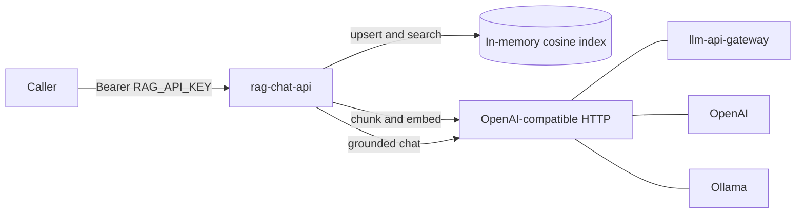
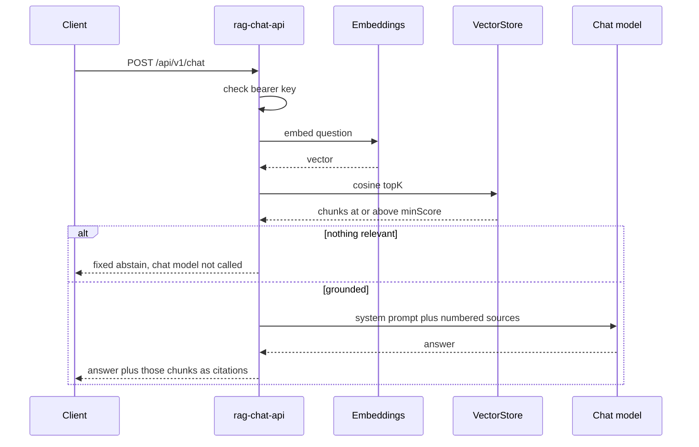

# rag-chat-api

Portfolio RAG service by Sandeep Vedavyas, senior backend engineer (Kotlin, Spring) in Berlin.

It ingests text or Markdown, chunks and embeds it, stores the vectors, and answers a question with the chunks it actually retrieved. The model call is an OpenAI-compatible HTTP API, so the same process can target [llm-api-gateway](https://github.com/sandeepvedavyas/llm-api-gateway), OpenAI, or Ollama by changing a base URL.

The gateway owns provider credentials and model routing. This service owns documents, retrieval, and grounded answers. v1 keeps the index in memory so you can run the demo without Postgres, Redis, or a vector database.

## Architecture





Ports, and the v1 adapter for each:

| Port | v1 adapter |
| --- | --- |
| `EmbeddingModel`, `ChatModel` | `OpenAiCompatibleClient` (`POST /embeddings`, `POST /chat/completions`) |
| `VectorStore` | `InMemoryVectorStore` (normalized cosine, read/write lock) |
| HTTP edge | WebFlux controllers, bearer filter, problem details |

`GATEWAY_BASE_URL` replaces `OPENAI_BASE_URL` when it is non-blank, and `GATEWAY_API_KEY` replaces `OPENAI_API_KEY` with it. A gateway key on its own does not override an OpenAI key. The upstream `Authorization` header is omitted when the resolved key is blank, which is what a local Ollama expects.

## Run in five minutes

Requires Java 21 for the Gradle path, or Docker for the image path. No API key is baked into the repo. Copy `.env.example` and put secrets only in your environment.

### Ollama, no paid key

```bash
cp .env.example .env
set -a && source .env && set +a

ollama pull llama3.2
ollama pull nomic-embed-text

./gradlew bootRun
```

Spring does not read `.env` by itself. `source` exports it. The defaults in `application.yml` match `.env.example`, so a machine that already has those Ollama models can skip the file and run `./gradlew bootRun` directly. The demo bearer token is `local-dev-key`.

### OpenAI

```bash
export RAG_API_KEY=local-dev-key
export OPENAI_BASE_URL=https://api.openai.com/v1
export OPENAI_API_KEY=replace-me
export OPENAI_CHAT_MODEL=gpt-4o-mini
export OPENAI_EMBEDDING_MODEL=text-embedding-3-small
./gradlew bootRun
```

### Sibling gateway

Run the gateway on its own port, then point this service at it. Chat and embedding model names must be ones the gateway will route.

```bash
export RAG_API_KEY=local-dev-key
export GATEWAY_BASE_URL=http://localhost:8081/v1
export GATEWAY_API_KEY=replace-me
export OPENAI_CHAT_MODEL=gpt-4o-mini
export OPENAI_EMBEDDING_MODEL=text-embedding-3-small
./gradlew bootRun
```

### Docker

Compose publishes the API on port 8080 and reaches Ollama on the host through `host.docker.internal`.

```bash
cp .env.example .env
docker compose up --build
```

`GET /` lists the routes and does not require a key. `GET /actuator/health` and `GET /actuator/info` are open. Everything else, including Prometheus, requires `Authorization: Bearer $RAG_API_KEY`.

## Smoke curls

```bash
export RAG_API_KEY=local-dev-key
export BASE=http://localhost:8080
```

Ingest a pasted note:

```bash
curl -sS -X POST "$BASE/api/v1/documents" \
  -H "Authorization: Bearer $RAG_API_KEY" \
  -H "Content-Type: application/json" \
  -d '{
    "title": "Parcel lock",
    "sourceName": "notes.md",
    "content": "# Parcel lock\n\nThe parcel-lock protocol cancels child coroutines when the parent scope is cancelled.\n"
  }'
```

Or upload a file:

```bash
curl -sS -X POST "$BASE/api/v1/documents/upload?title=Parcel%20lock" \
  -H "Authorization: Bearer $RAG_API_KEY" \
  -F "file=@notes.md;type=text/markdown"
```

The same normalized body a second time returns the original document with `"created": false` and does not embed again.

Ask:

```bash
curl -sS -X POST "$BASE/api/v1/chat" \
  -H "Authorization: Bearer $RAG_API_KEY" \
  -H "Content-Type: application/json" \
  -d '{
    "question": "What does the parcel-lock protocol do to child coroutines when the parent scope is cancelled?",
    "topK": 4
  }'
```

A grounded response looks like this. `model` is whatever the upstream chat call returned. `citations` are the retrieved chunks, numbered the same way as the prompt (`[1]`, `[2]`).

```json
{
  "answer": "Child coroutines are cancelled when the parent scope is cancelled [1].",
  "model": "llama3.2",
  "citations": [
    {
      "index": 1,
      "documentId": "…",
      "chunkId": "…:0",
      "title": "Parcel lock",
      "sourceName": "notes.md",
      "score": 0.82,
      "text": "The parcel-lock protocol cancels child coroutines when the parent scope is cancelled."
    }
  ]
}
```

A question with no chunk at or above `rag.retrieval.min-score` (default `0.2`) returns HTTP 200 and does not call the chat model:

```json
{
  "answer": "I don't have enough indexed context to answer that.",
  "model": null,
  "citations": []
}
```

Other calls:

```bash
curl -sS "$BASE/api/v1/documents" -H "Authorization: Bearer $RAG_API_KEY"
curl -sS -X DELETE "$BASE/api/v1/documents/{id}" -H "Authorization: Bearer $RAG_API_KEY"
curl -sS "$BASE/actuator/prometheus" -H "Authorization: Bearer $RAG_API_KEY"
```

Missing or wrong bearer tokens get `401` with `WWW-Authenticate: Bearer` and a problem-details body. Empty documents are `400`. Bodies over `rag.ingest.max-bytes` (default 1 MiB) are `413`. Non-text uploads are `415`. Upstream timeouts are `504`. Other upstream failures are `502`, or `503` when the upstream returns `429`.

## What you can observe

- `X-Request-Id` is echoed, or generated, and written into the MDC key `requestId`. Micrometer Tracing adds `traceId` and `spanId` on the same log line.
- Timers: `rag.ingest` (`created` or `duplicate`), `rag.chat` (`success`, `empty`, or `error`), `rag.llm` (`operation` = `embeddings` or `chat`).
- Counters: `rag.ingest.duplicate` for a content-hash hit that skips the embedder, `rag.chat.empty_context` for an abstain.
- `/actuator/health` reports index document and chunk counts. It does not call the model.
- Startup logs the LLM base URL with userinfo stripped, the model names, and whether an upstream key is present. The key itself is never logged. The local default `RAG_API_KEY` logs a warning.

## Design trade-offs

- **In-memory cosine, not ANN.** Vectors are L2-normalized on write and ranked by dot product under a read/write lock. A restart drops the index. A few thousand chunks are fine. Millions are not. `VectorStore` is the swap point for pgvector or another engine. The API does not have to change.
- **Citations are retrieved chunks, not model-claimed spans.** The prompt tells the model to cite `[n]` and to ignore instructions inside the sources. The HTTP response still returns the chunks that passed the score threshold, including when the model forgets the markers. That is the auditable part.
- **Abstain is cheaper than an ungrounded answer.** Low similarity skips the chat call and returns a fixed sentence. The threshold will hide a weak-but-real match. Raise `topK` or lower `rag.retrieval.min-score` when that happens.
- **Chunking is structural, not semantic.** Windows break on paragraphs, Markdown headings, lines, then spaces, with a character overlap. The same text always chunks the same way, which is what the tests lock. A semantic chunker would be a different component behind the same ingest service.
- **Idempotent ingest is by body hash, not by title.** Re-posting the same normalized text returns the first document and does not embed again. A new title on the same body does not rename it.
- **One service key.** Comparison is SHA-256 then `MessageDigest.isEqual`, so the check does not return early on length. This matches a gateway-style demo credential. It is not a user directory, not a rotation list, and not Spring Security. A blank key fails closed.
- **No conversation memory and no streaming.** Each chat call is one question. Streaming would need the citations to arrive before the tokens, which is a different response contract.
- **No hybrid lexical search and no reranker.** Identifier-heavy notes will do better once a BM25 pass sits next to cosine. v1 keeps a single score you can explain.
- **WebFlux for the upstream I/O.** Embedding and chat are non-blocking WebClient calls with a timeout and a short retry on `429` and `5xx`. The index scan stays synchronous because it is in-process CPU. Moving that call onto `boundedElastic` becomes worthwhile when the index stops being small.
- **Retries do not include a fallback model.** A failed upstream stays a failed request. The service does not answer from the model's priors.

## Tests

`./gradlew test` is the happy path without a paid API. Unit tests cover the chunker, the index, the API-key check, and config resolution. `OpenAiCompatibleClientTest` uses OkHttp `MockWebServer` for ordering of embedding rows, the bearer header, a single retry on `500`, and no retry on `400`. `RagApiIntegrationTest` boots the real WebFlux stack against that fake server: ingest, duplicate upload, auth, grounded chat with a citation, and abstain when the question does not match.

## Layout

```
src/main/kotlin/com/sandeepvedavyas/rag
  api/          controllers, DTOs, problem details
  auth/         bearer filter and request id
  chat/         retrieval policy and prompt
  config/       RagProperties and client wiring
  ingest/       chunker and ingest service
  llm/          OpenAI-compatible HTTP adapter
  retrieval/    VectorStore and the in-memory index
```

## Configuration

| Variable | Purpose | Default |
| --- | --- | --- |
| `RAG_API_KEY` | Bearer token for this API | `local-dev-key` |
| `OPENAI_BASE_URL` | OpenAI-compatible origin, including `/v1` | `http://localhost:11434/v1` |
| `OPENAI_API_KEY` | Upstream bearer token. Blank omits the header | empty |
| `OPENAI_CHAT_MODEL` | Chat model name | `llama3.2` |
| `OPENAI_EMBEDDING_MODEL` | Embedding model name | `nomic-embed-text` |
| `GATEWAY_BASE_URL` | When set, replaces `OPENAI_BASE_URL` | empty |
| `GATEWAY_API_KEY` | Upstream key used together with `GATEWAY_BASE_URL` | empty |
| `SERVER_PORT` | Listen port | `8080` |

Chunk size, overlap, batch size, `topK`, minimum score, timeout, and retries live under the `rag` prefix in `src/main/resources/application.yml`.

Changing the embedding model while chunks are already indexed returns `409` until you delete those documents. The index remembers the vector width and refuses a mix.
